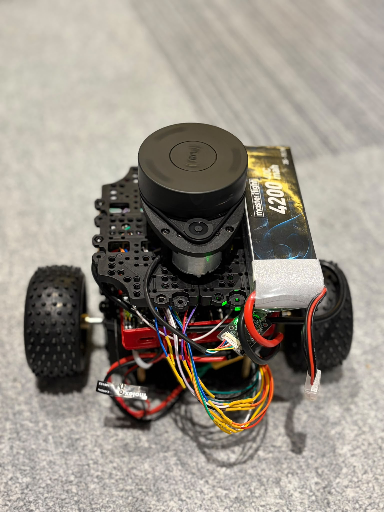
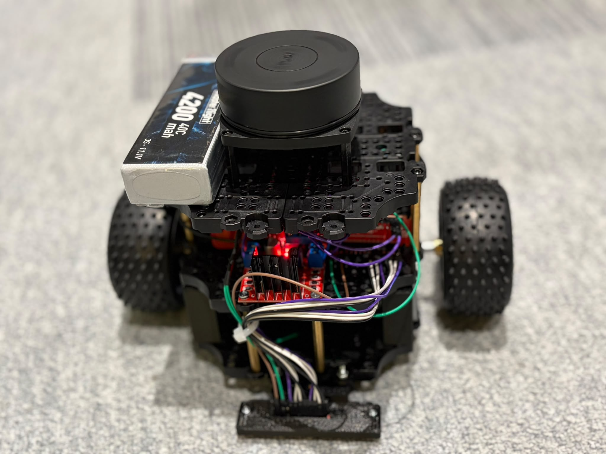
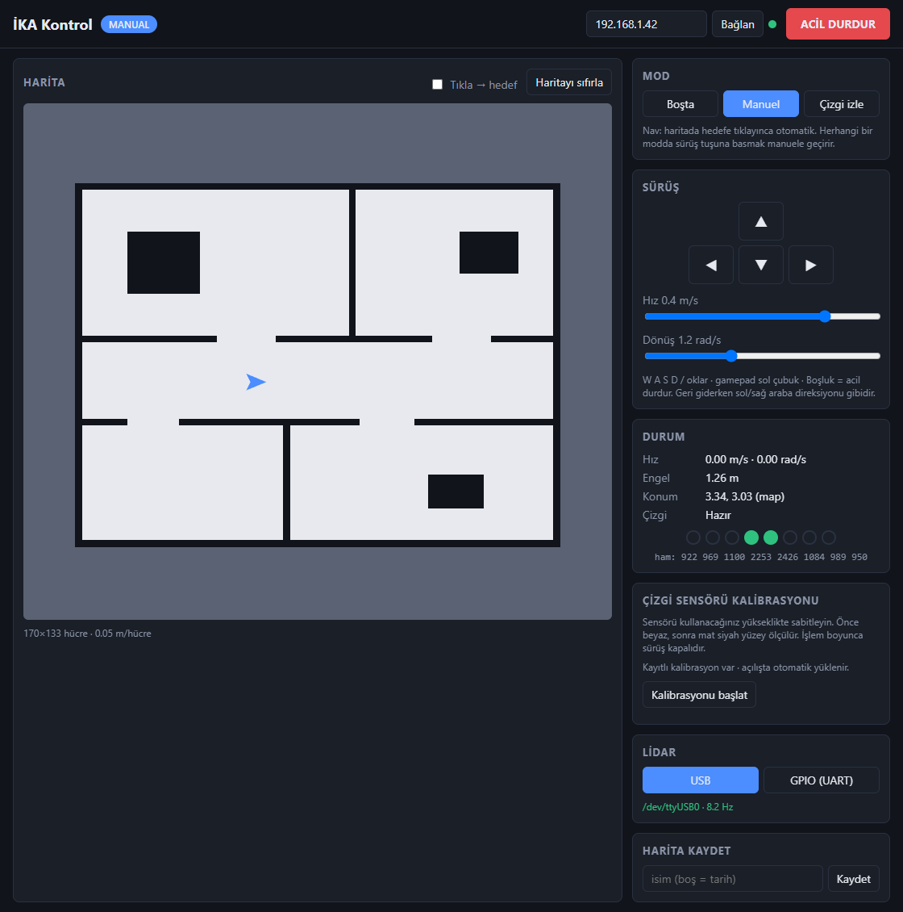
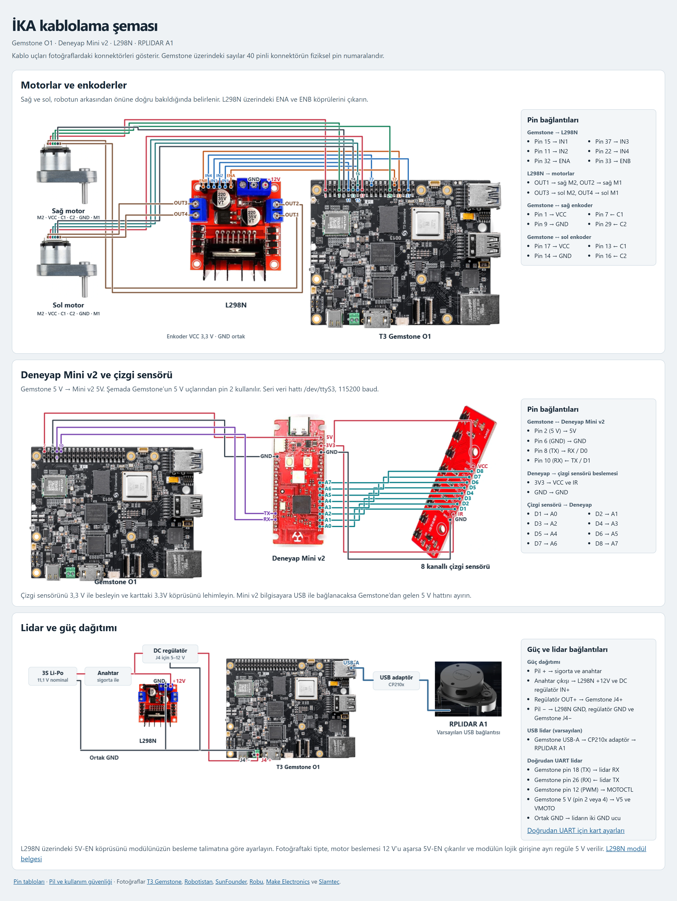

# İKA ROS

<p align="center">
  <a href="docs/img/ika-arka.png"></a>
  <a href="docs/img/ika-on.png"></a>
</p>

İKA ROS, T3 Gemstone O1 tabanlı, diferansiyel sürüşlü bir kara robotudur. Robot üzerinde **Ubuntu 24.04 ve ROS 2 Jazzy** çalışır. Robot çizgi izleyebilir, lidar ile çevresinin haritasını çıkarabilir ve Nav2 etkinleştirildiğinde kayıtlı harita üzerinde belirlenen bir hedefe gidebilir.

- **Manuel sürüş** için klavye, ekrandaki yön tuşları veya gamepad kullanılır. Tekerlek hızı enkoderlerle ölçülür, odometri kart üzerindeki IMU ile birleştirilir.
- **Çizgi izleme** için sekiz kanallı analog sensör Deneyap Mini v2 üzerinden okunur. Beyaz ve siyah zemin ölçümleri web arayüzünden kaydedilir.
- **Haritalama ve navigasyon** için RPLIDAR A1 kullanılır. Harita kaydedilebilir ve Nav2 etkinleştirildiğinde harita üzerinden hedef verilebilir.

## İlk kullanım

### 1. Gemstone O1’e Ubuntu 24.04 kurun

1. Bilgisayarınıza Gem Imager’ı kurun ve en az 32 GB kapasiteli bir microSD kartı okuyucuyla bilgisayara takın. [Gem Imager indirme sayfası](https://t3gemstone.org/tr/software)
2. Gem Imager’da **T3-GEM-O1** modelini, **Ubuntu 24.04 (Noble) Minimal** imajını ve hedef olarak microSD kartı seçin. Özelleştirme ekranında kullanıcı parolasını belirleyin. Uzaktan bağlanacaksanız SSH’ı etkinleştirin. Wi-Fi bilgilerini de bu ekrandan girebilirsiniz. Ardından imajı yazın.
3. Gemstone kapalıyken microSD kartı takın ve açılış anahtarlarını **SD card** konumuna getirin. Ardından kartı çalıştırın. Dahili eMMC kullanacaksanız üreticinin eMMC yazma ve açılış adımlarını izleyin. [Gemstone hızlı başlangıç kılavuzu](https://docs.t3gemstone.org/tr/quickstart)
4. Gemstone’u Ethernet veya Wi-Fi üzerinden internete bağlayın. Aynı ağdaki bilgisayardan SSH ile ya da Gemstone’a bağlı ekran ve klavyeyle oturum açın. [Ağ bağlantısı kılavuzu](docs/wifi.md)

### 2. İKA yazılımını Gemstone’a kurun

Gemstone’da `sudo` yetkili bir kullanıcıyla aşağıdaki komutları çalıştırın. Kurulum betiği ROS 2 Jazzy’yi ve bağımlılıkları yükleyip çalışma alanını derler.

```bash
git clone --branch codex/readme-donanim https://github.com/Emirsw/ika-ros.git ~/ika-ros
cd ~/ika-ros
bash deploy/install-native.sh
```

### 3. Deneyap Mini v2’yi programlayın ve donanımı kontrol edin

Bilgisayarınıza **Deneyap Kart IDE**’yi kurun. IDE’de `deneyap_line.ino` dosyasını açın, **Deneyap Mini v2** kartını ve bağlı portu seçin, ardından **Derle ve Yükle**’ye tıklayın. [Resmî IDE kurulum kılavuzu](https://docs.deneyapkart.org/tr/IDE/Deneyap-Kart-IDE-Setup) · [Mini v2 yükleme ayarları ve port kontrolü](firmware/deneyap_line/README.md)

Güç kapalıyken [pin bağlantılarını](#donanım-ve-pin-bağlantıları) tamamlayın. Gemstone’da motor PWM hatları için [donanım ayarlarını](docs/donanim.md) uygulayın ve değişikliklerin ardından kartı yeniden başlatın. İlk sürüşten önce [pil ve kullanım güvenliği](docs/guvenlik.md) bölümünü okuyun, tekerlekleri yerden kaldırarak [saha testini](docs/saha-testi.md) yapın.

### 4. Robotu başlatın ve arayüzü açın

Gemstone’da çalıştırın:

```bash
cd ~/ika-ros
sudo bash deploy/start-native.sh
```

Aynı ağa bağlı bilgisayardan [İKA Kontrol arayüzünü](#web-arayüzü) açın.

### 5. Çizgi sensörünü kalibre edin ve harita çıkarın

- **Çizgi izleme** için arayüzde **Çizgi sensörü kalibrasyonu → Kalibrasyonu başlat** seçeneğini kullanın. Sensörü çalışma yüksekliğinde tutarak sekiz kanalın tamamını önce beyaz, ardından mat siyah yüzey üzerinde ölçün. Ölçümler kaydedilince **Çizgi izle** modunu deneyin.
- **Haritalama** varsayılan olarak açıktır. Robotu **Manuel** modda gezdirin ve **Harita kaydet** panelini kullanın. Kayıtlı haritada hedefe gitmek için `slam_mode:=localization`, uzantısız `map` yolu ve `nav:=true` ile başlatın. [Başlatma ve servis ayarları](docs/native-kurulum.md)

### Açılışta otomatik başlatma

Elle başlattığınız oturumu `Ctrl+C` ile durdurup depo dizininde şu komutu çalıştırın:

```bash
sudo bash deploy/install-service.sh 1
```

`1`, robotun `ROS_DOMAIN_ID` değeridir. Aynı ağdaki her robota farklı bir değer verin. Servis ayarları, günlükler ve güncelleme adımları [Docker’sız kurulum kılavuzunda](docs/native-kurulum.md) yer alır.

<details>
<summary>Docker ile çalıştırma ve donanımsız deneme</summary>

Docker ve Compose kurulu Linux sisteminde, depo dizininden robotu başlatın:

```bash
ROS_DOMAIN_ID=1 docker compose up --build -d
docker compose logs -f
```

Donanımsız arayüz denemesi için aynı dizinde imajı oluşturup aşağıdaki komutları çalıştırın. `backend:=mock` motor ve enkoderleri benzetir. Tarayıcıda `http://localhost:8000` adresini açın.

```bash
docker compose build
docker run --rm -p 8000:8000 -p 9090:9090 ika-ros:jazzy ros2 launch ika_bringup robot.launch.py backend:=mock fusion:=false line:=false slam:=false
```

</details>

## Web arayüzü

[](docs/img/ika-web-arayuzu.png)

*İKA Kontrol ekranı, kayıtlı bir lidar taramasından aktarılan harita ve örnek sensör değerleriyle.*

### Arayüze nasıl bağlanılır?

1. Gemstone’da İKA yazılımını [başlatın](#4-robotu-başlatın-ve-arayüzü-açın). Gemstone terminalinde `hostname -I` komutuyla robotun yerel ağdaki IP adresini öğrenin.
2. Aynı ağa bağlı bilgisayarda tarayıcıyı açın ve `http://<robot-ip>:8000` adresine gidin. Örneğin robotun IP’si `192.168.1.42` ise adres `http://192.168.1.42:8000` olur.
3. Sağ üstteki bağlantı göstergesi yeşile dönünce arayüz hazırdır. Gösterge kırmızı kalırsa **robot adresi** alanına Gemstone’un IP’sini yazıp **Bağlan**’a tıklayın. Sayfa `8000`, ROS bağlantısı ise `9090` portunu kullanır. Bağlantı sorunu sürerse [ağ ve servis kontrollerini](docs/wifi.md) izleyin.

### Arayüzden neler yapılır?

| Panel | İşlev |
| --- | --- |
| **Mod ve Sürüş** | Boşta, Manuel veya Çizgi izle modunu seçin. Manuel sürüşte ekran tuşlarını, WASD veya ok tuşlarını ya da gamepad’i kullanın. Hızı ve dönüş hızını ayarlayın. |
| **Harita** | SLAM ile oluşan haritayı ve robotun konumunu izleyin. **Harita kaydet** paneliyle haritayı kaydedin. Nav2 açıkken **Tıkla → hedef** seçeneğiyle harita üzerinden hedef verin. |
| **Durum ve kalibrasyon** | Hızı, engel mesafesini ve çizgi sensörü ölçümlerini izleyin. Deneyap seri sensörünü beyaz ve siyah yüzeylerle kalibre edin. |
| **Lidar** | Kablolamaya göre **USB** veya **GPIO (UART)** seçin ve tarama hızını kontrol edin. |

Sürüşü durdurmak için **ACİL DURDUR** düğmesini veya **Boşluk** tuşunu kullanın.

## Donanım ve pin bağlantıları

Robotun ana bileşenleri **T3 Gemstone O1**, **L298N** motor sürücüsü, enkoderli iki **Waveshare DCGM-3865** motor, **Deneyap Mini v2**, sekiz kanallı analog çizgi sensörü ve **RPLIDAR A1**’dir.

[](docs/img/ika-kablolama.png)

- [Motor ve enkoder bağlantıları](docs/img/kablolama/motor-ve-enkoder.png)
- [Deneyap Mini v2 ve çizgi sensörü bağlantıları](docs/img/kablolama/deneyap-ve-cizgi-sensoru.png)
- [Lidar ve güç bağlantıları](docs/img/kablolama/lidar-ve-guc.png)

[Fotoğraflı HTML şeması](docs/kablolama.html) · [Gemstone O1 40 pin yerleşimi](docs/img/pinout.svg) · [Kablolama tablosu ve donanım ayarları](docs/donanim.md) · [Yazılımdaki pin yapılandırması](src/ika_bringup/config/hardware.yaml)

Aşağıdaki pin numaraları Gemstone’un 40 pinli konnektöründeki **fiziksel numaralardır**. Sağ ve sol, robotun arkasından önüne doğru bakıldığında belirlenir.

| Bileşen | Gemstone bağlantısı |
| --- | --- |
| L298N, sağ motor | IN1 → 15, IN2 → 11, ENA → 32 |
| L298N, sol motor | IN3 → 37, IN4 → 22, ENB → 33 |
| Sağ enkoder | C1 → 7, C2 → 29, 3,3 V → 1 |
| Sol enkoder | C1 → 13, C2 → 16, 3,3 V → 17 |
| Deneyap Mini v2 | 5V → Gemstone 5 V (şemada pin 2), GND → 6, TX (D1) → 10, RX (D0) → 8. Veri hattı `/dev/ttyS3`, 115200 baud. |
| RPLIDAR A1, varsayılan | Kendi USB adaptörüyle Gemstone’a bağlanır. |
| RPLIDAR A1, doğrudan UART | TX → 26, RX → 18, MOTOCTL → 12. Veri hattı `/dev/ttyS0`. [Gerekli donanım ayarları](docs/donanim.md#lidar-bağlantısı-usb-veya-gpio). |

Çizgi sensörünün D1–D8 çıkışlarını sırasıyla **Mini v2’nin A0–A7** girişlerine bağlayın. Sensörü 3,3 V ile besleyin ve üzerindeki `3.3V` köprüsünü kontrol edin. Ortak GND ve PWM bağlantıları için tam şemayı izleyin.

## Proje belgeleri

| Belge | İçerik |
| --- | --- |
| [Mimari](docs/mimari.md) | ROS 2 paketleri, konular ve sürüş modları |
| [Donanım](docs/donanim.md) | Pinler, PWM, UART seçenekleri ve sensör kalibrasyonu |
| [Saha testi](docs/saha-testi.md) | İlk çalıştırma, motor yönü ve enkoder kontrolleri |

## Lisans

[Apache-2.0](LICENSE). ICM-20948 sürücüsünün kaynak dosyaları T3 Foundation’a aittir ve Apache-2.0 lisansıyla dağıtılır.
