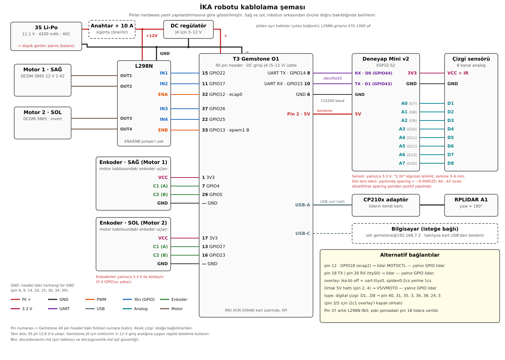

# Donanım ve pin haritası

Tüm bağlantılar yazılımda tek dosyada:
[`src/ika_bringup/config/hardware.yaml`](../src/ika_bringup/config/hardware.yaml).
Pinler Gemstone hat adlarıyla (`"GPIO22"`), PWM'ler modül adlarıyla (`"ecap0"`)
yazılır; yazılım bunları karttaki hatlara kendisi çözer. Robotta ilk komut:

```bash
ros2 run ika_base hw_check pins --config <hardware.yaml>
```

## Bileşenler

| Bileşen | Bağlantı | Yazılım |
|---|---|---|
| T3 Gemstone O1 | — | Ubuntu 24.04 + ROS 2 Jazzy (doğrudan kurulum veya Docker) |
| L298N + 2 × Waveshare DCGM-3865 (12 V, 1:42, 240 rpm) | IN1–IN4 (GPIO), ENA/ENB (PWM) | `ika_base` |
| Motor enkoderleri (hall, AB, 546 PPR çıkış milinde, dahili pull-up) | 4 × GPIO | `ika_base` |
| ICM-20948 IMU | kart üzerinde, SPI `/dev/spidev0.3` | `ika_imu` |
| RPLIDAR A1 | USB adaptör (varsayılan) **veya** UART `/dev/ttyS0` (pin 18/26) + motor PWM | `sllidar_ros2`, `ika_hal` |
| 8 kanallı çizgi sensörü ("8路寻线模块", QTR-8 benzeri, analog çıkış) | Deneyap Mini v2 (bu robotta; 1A v2 de olur) ADC → UART `/dev/ttyS3` (varsayılan) **veya** 8 × GPIO | `ika_line` |
| 3S Li-Po (11,1 V, 4200 mAh, 40C) | L298N beslemesi. Gemstone J4 için üretici sınırlarına uygun, regüle DC besleme. Tüm GND uçları ortak. | — |

## Kablolama şeması



Sinyal bağlantıları `hardware.yaml` yapılandırmasını gösterir. Gemstone’un
besleme sınırları için [pil ve kullanım güvenliği kılavuzuna](guvenlik.md) bakın.

## 40 pinli konnektör

[40 pin yerleşim görseli](img/pinout.svg). Tablodaki pin numaraları kart
üzerindeki fiziksel numaralardır.

**Sol/sağ** robotun arkasından, çizgi sensörünün olduğu öne bakarak söylenir.
Şemadaki Motor 1 (L298N OUT1/OUT2) robotun **sağ**, Motor 2 (OUT3/OUT4) **sol**
tekeridir; `hardware.yaml`'daki `left` / `right` buna göredir. Motorlar başka
tarafa takılırsa kablo değil `left` ve `right` blokları (yön ayarlarıyla
birlikte) yer değiştirir; doğrulamak için `hw_check motors` önce `left`'i döndürür.

| Pin | Sinyal | Bağlantı | `hardware.yaml` |
|---|---|---|---|
| 1 | 3V3 | Motor 1 enkoder VCC | — |
| 2, 4 | 5V | Lidar V5 ve VMOTO (yalnız GPIO lidar) | — |
| 3 | GPIO2 | Çizgi D4 (yalnız `type: digital`, i2c1 overlay'i kapalıyken) | `pins[3]` |
| 5 | GPIO3 | Çizgi D8 (〃) | `pins[7]` |
| 6 | GND | ortak GND, Deneyap GND | — |
| 7 | GPIO4 | Motor 1 (sağ teker) enkoder C1 | `right.enc_a` |
| 8 | GPIO14 (UART-MAIN1 TX) | Deneyap RX | `line_sensor_node.serial.port` |
| 10 | GPIO15 (UART-MAIN1 RX) | Deneyap TX | 〃 |
| 11 | GPIO17 | L298N IN2 (sağ teker) | `right.in2` |
| 12 | GPIO18 (ecap2) | Lidar MOTOCTL (yalnız GPIO bağlantısı) | `lidar_manager_node.gpio.pwm: ecap2` |
| 13 | GPIO27 | Motor 2 (sol teker) enkoder C1 | `left.enc_a` |
| 15 | GPIO22 | L298N IN1 (sağ teker) | `right.in1` |
| 16 | GPIO23 | Motor 2 (sol teker) enkoder C2 | `left.enc_b` |
| 17 | 3V3 | Motor 2 enkoder VCC, çizgi sensörü VCC | — |
| 18 | GPIO24 (UART-WKUP0 TX) | Lidar RX (yalnız GPIO lidar) | `lidar_manager_node.gpio.port` |
| 22 | GPIO25 | L298N IN4 (sol teker) | `left.in2` |
| 24 | GPIO8 | Çizgi D7 (yalnız `type: digital`) | `pins[6]` |
| 26 | GPIO7 (UART-WKUP0 RX) | Lidar TX (yalnız GPIO lidar) | 〃 |
| 29 | GPIO5 | Motor 1 (sağ teker) enkoder C2 | `right.enc_b` |
| 31 | GPIO6 | Çizgi D2 (yalnız `type: digital`) | `pins[1]` |
| 32 | GPIO12 (ecap0) | L298N ENA (sağ teker) | `right.pwm: ecap0` |
| 33 | GPIO13 (epwm1 B) | L298N ENB (sol teker) | `left.pwm: epwm1:1` |
| 35 | GPIO19 | Çizgi D3 (yalnız `type: digital`) | `pins[2]` |
| 36 | GPIO16 | Çizgi D5 (yalnız `type: digital`) | `pins[4]` |
| 37 | GPIO26 | L298N IN3 (sol teker) | `left.in1` |
| 38 | GPIO20 | Çizgi D6 (yalnız `type: digital`) | `pins[5]` |
| 39 | GND | Çizgi sensörü GND (yalnız `type: digital`) | — |
| 40 | GPIO21 | Çizgi D1 (yalnız `type: digital`) | `line_sensor_node.pins[0]` |

### Çizgi sensörü

Kitteki sensör **"8路寻线模块 / 8 sensor lines follow"** etiketli 8 kanallı
kart (Pololu QTR-8 tasarımının klonu). Her kanal 10 kΩ ile VCC'ye çekili bir
fototransistör: yansıma arttıkça çıkış voltajı düşer, siyah çizgide ≈ VCC.
Karşılaştırıcı yoktur, çıkış analogdur. Kart zemine **3–6 mm** mesafede olmalı.

- **Asla 5 V vermeyin**, kartın üstündeki **"3.3V" pedi lehimli** olmalı:
  köprü açıkken LED'ler 3.3 V'ta çok zayıf yanar.
- Robot 2'de 1 cm yükseklikte beyaz zemin 2.7–3.0 V, siyah 3.1 V ölçüldü:
  bu kadar yüksekte fark 100 mV'a iner ve Gemstone GPIO'su her kanalı 1 okur.
  Sensörü 3–6 mm'ye indirin.

İki bağlantı vardır, `hardware.yaml` → `line_sensor_node.type` ile seçilir.

#### Deneyap Mini v2 üzerinden (varsayılan, `type: serial`)

Mini v2, sekiz analog kanalı milivolt cinsinden okur ve Gemstone’un
`/dev/ttyS3` UART hattına 115200 baud ile saniyede yaklaşık 50 ölçüm gönderir.
Her iki kartın UART hatları 3,3 V lojik seviyesi kullanır.

| Deneyap Mini v2 | Bağlantı |
|---|---|
| **TX / D1** (GPIO43) | Gemstone pin 10 (GPIO15, UART RX) |
| **RX / D0** (GPIO44) | Gemstone pin 8 (GPIO14, UART TX) |
| **GND** | Gemstone pin 6 |
| **3V3** | sensör VCC ve IR |
| **GND** | sensör GND |
| **A0 … A7** | sensör D1 … D8 (ESP32-S2 GPIO 7, 8, 9, 10, 11, 12, 13, 16) |

- Mini v2’yi Gemstone’un USB-A portundan Mikro USB kablosuyla besleyin.
  Sinyal bağlantısında TX ile RX’i çaprazlayın ve GND uçlarını birleştirin.
- Doğrudan bağlı lidar, pin 18 ve 26’daki ayrı UART’ı (`/dev/ttyS0`) kullanır.
  [Lidar bağlantı seçenekleri](#lidar-bağlantısı-usb-veya-gpio)

[Mini v2 yazılımını yükleme](../firmware/deneyap_line/README.md). Aynı kaynak kod
Deneyap Kart 1A v2 için de derlenebilir. Bu durumda Deneyap Kart IDE’de ilgili kartı
seçin ve o kartın pin etiketlerini izleyin.

**Kalibrasyon** (robot çalışırken, robot `idle` modda). Kanal başına eşik beyaz ve
siyah ölçümün ortasıdır; kalibrasyon olmadan hiçbir kanal çizgi görmez.

**Web arayüzünden:** Çizgi sensörü kalibrasyonu panelinde **Kalibrasyonu başlat**
seçin. Robot Boşta moduna alınır; klavye, gamepad, ekran sürüşü ve harita hedefi
bu sekmede işlem kapanana kadar engellenir. Sensörü çalışma yüksekliğinde sabit
tutup sekiz gözün tamamının altına beyaz yüzey koyun ve **Beyaz hazır — ölç**
seçin. Sonra yüksekliği değiştirmeden mat siyah yüzey koyup **Siyah hazır — ölç
ve kaydet** seçin. Her tıklamadan sonra yaklaşık 1,2 saniye sabit tutun.

Panel son kayıtlı beyaz/siyah değerleri, eşikleri ve kanal başına ayrım payını
mV olarak gösterir; 200 mV altındaki dar paylar vurgulanır. Yeni ölçüm başarısız
olursa veya işlem kapatılırsa önceki kayıt korunur. Kayıtlı ayarlar her açılışta
otomatik yüklenir; yükseklik, zemin veya ışık değişince tekrar kalibre edin.
`qtr_rc`/`digital` tiplerinde veya sensör kapalıyken bu panel kullanılamaz.

**Terminalden:** aynı servisler kullanılabilir. Robot Boşta, `/cmd_vel` sıfır ve
canlı olmalı; son bir saniyede en az 10 ölçüm gereklidir. Beyaz referans 15 dakika
geçerlidir; hareket, Boşta modundan çıkış veya veri kesilmesi referansı iptal eder.

```bash
# sensör beyaz zeminin 3–6 mm üstünde, ~1 sn sabit
ros2 service call /line/calibrate_white std_srvs/srv/Trigger
# sensör siyah bandın üstünde, ~1 sn sabit
ros2 service call /line/calibrate_black std_srvs/srv/Trigger
```

Her kanalda beyaz/siyah farkı en az 100 mV olmalı ve ölçümler örtüşmemeli; yoksa
hangi kanalın ayrışmadığı yanıtta yazar ve eski kalibrasyon korunur. Sonuç robotta
`~/.ika/line_calibration.json` dosyasına yazılır (servis root çalıştığı için
`/root/.ika/`). Canlı değerler: `ros2 topic echo /line/state --field raw` (mV).
Arayüz durumu: `/line/calibration_status` (`std_msgs/String`, JSON, 2 Hz).
`supported`, `ready`, `calibrated`, `white_ready`, `samples` ve kayıt varsa
`white_mv`, `black_mv`, `threshold_mv` alanlarını içerir. Kalibrasyon servisi
yalnız başarılı siyah ölçümünde dosyayı atomik olarak değiştirir.

#### Doğrudan Gemstone GPIO'larına (`type: digital`)

Deneyap olmadan sensör çıkışları Gemstone GPIO'suyla eşiklenir (siyah = 1). Beyaz
zeminde çıkışın 0.8 V altına inmesi gerekir; bu yalnızca sensör zemine yakın ve
LED'ler parlakken olur.

| Sensör | Gemstone |
|---|---|
| VCC | pin 17 (**3.3 V**) |
| GND | pin 39 |
| IR | boşta (LED'ler açık) |
| D1 … D8 | pin 40, 31, 35, 3, 36, 38, 24, 5 |

- 5 V verilirse çıkışlar VCC'ye çekili olduğu için Gemstone pinlerine zarar verir.
- D1–D8 kablosu takılı değilken giriş boşta kalır ve 1 okuyabilir: Gemstone
  pad'lerinde iç pull-up/down yazılımdan açılamıyor. "Hep 1" görülürse önce
  VCC/GND ve D kablolarını kontrol edin.
- D4/D8 için kullanılan GPIO2/GPIO3 (pin 3/5) I2C1 hattıdır: bu bağlantıyı
  kullanacaksanız `uEnv.txt`'den `i2c1-400000` overlay'ini çıkarın (robotta
  I2C1'e bağlı cihaz yok). D7 için kullanılan GPIO8 (pin 24) SPI0 seçim pinidir
  (IMU kart içinde ayrı bir seçim hattı kullanır).
- Pin 12, 18 ve 26 GPIO lidara, pin 37 L298N IN3'e ayrılmıştır; çizgi sensörüne
  verilmez.

## Lidar bağlantısı: USB veya GPIO

İki yol vardır; arayüzdeki **Lidar** panelinden seçilir, seçim robotta
(`~/.ika/lidar_source`) saklanır. Varsayılan USB'dir.

**USB (varsayılan):** Lidarı kendi adaptör kartıyla Gemstone'un USB portuna
takın; başka kablo gerekmez. Port `/dev/serial/by-id/` altında kendiliğinden
bulunur, motoru adaptör sürer. Minimal Gemstone imajında CP210x USB-seri
sürücüsü eksik olabilir: `lsusb` adaptörü gösterip `/dev/ttyUSB0` oluşmuyorsa
T3 apt deposundan `sudo apt install kernel-module-cp210x-$(uname -r)` ile
kurup `sudo modprobe cp210x` çalıştırın.

**GPIO:** Adaptör olmadan lidarın 7 pinli kablosu doğrudan header'a, ikinci
UART'a (UART-WKUP0, `/dev/ttyS0`) bağlanır; pin 8/10'daki UART Deneyap'ındır.

| Lidar | Gemstone |
|---|---|
| V5, VMOTO | pin 2, pin 4 (5V) |
| GND (ikisi) | herhangi bir GND |
| TX | pin 26 (GPIO7, UART-WKUP0 RX) |
| RX | pin 18 (GPIO24, UART-WKUP0 TX) |
| MOTOCTL | pin 12 (GPIO18, `ecap2` PWM) |

Bu yol için `ika-bt-off`, `uart-ttys0` ve `ecap2` overlay'leri açık olmalı,
`spidev0-2cs` yerine `spidev0-1cs` seçilmeli ve `/dev/ttyS0` bulunmalıdır
(bkz. [Overlay'ler](#overlayler-bootuenvtxt)). Pin 26 kartta
aynı zamanda SPI CS2'ye bağlıdır: `spidev0-2cs` açıkken CS2 bu hattı sürer ve
lidarın TX'iyle çakışır (`spidev0-1cs` aynı overlay'dir, yalnız CS2'yi bırakır).
Motor PWM'i yalnızca GPIO seçiliyken sürülür.

## Overlay'ler (`/boot/uEnv.txt`)

PWM kanalları `overlays=` satırına eklenen overlay'lerle açılır
([T3 PWM belgesi](https://docs.t3gemstone.org/tr/boards/o1/peripherals/pwm.md)):

```
k3-am67a-t3-gem-o1-pwm-ecap0-gpio12     # ENA
k3-am67a-t3-gem-o1-pwm-ecap2-gpio18     # lidar motoru (yalnız GPIO lidar bağlantısı)
k3-am67a-t3-gem-o1-pwm-epwm1-gpio13     # ENB
k3-am67a-t3-gem-o1-spidev0-1cs          # spidev0-2cs yerine: pin 26'yı lidara bırakır
k3-am67a-t3-gem-o1-ika-bt-off           # Bluetooth UART'ını kapatır (repodan, aşağıda)
k3-am67a-t3-gem-o1-uart-ttys0           # lidar UART'ı, pin 18/26 (yalnız GPIO lidar)
```

Dosya uzantısı ve satır biçimi için kartta `ls /boot/overlays` ve mevcut
`uEnv.txt` örneğine bakın. Değişiklikten sonra yeniden başlatın.

`uart-ttys0` tek başına açılmaz: kart üstündeki Bluetooth'un UART'ı (`main_uart6`)
aynı pad'leri RTS/CTS için tutar ve açılışta
`pin PIN10 already requested by 2860000.serial` hatası verir; `/dev/ttyS0`
görünür ama çalışmaz. [`deploy/overlays/k3-am67a-t3-gem-o1-ika-bt-off.dts`](../deploy/overlays/k3-am67a-t3-gem-o1-ika-bt-off.dts)
Bluetooth UART'ını kapatır (Wi-Fi aynı çipte ama SDIO'dan bağlı, etkilenmez).
Robotta derleyip kurun ve `overlays=` satırında `uart-ttys0`'dan önce yazın:

```bash
dtc -@ -I dts -O dtb -o /tmp/k3-am67a-t3-gem-o1-ika-bt-off.dtbo \
    deploy/overlays/k3-am67a-t3-gem-o1-ika-bt-off.dts
sudo cp /tmp/k3-am67a-t3-gem-o1-ika-bt-off.dtbo /boot/overlays/
```

Yeniden başlatınca `dmesg | grep ttyS0` içinde `2b300000.serial: ttyS0` satırı
görünmelidir. Pin 18 ile 26'yı bir jumper'la bağlayıp `/dev/ttyS0`'a yazılanın
geri okunması (geri döngü testi) yolun sağlam olduğunu doğrular.

**Açmayın**, açarsanız kullandığımız GPIO'ları başka işe alırlar:

| Overlay | Bozduğu |
|---|---|
| `uart-ttys6` | GPIO4 (enkoder), GPIO17 (IN2); ayrıca Bluetooth'u kapatır |
| `spidev0-2cs` | GPIO7 (pin 26, lidar UART RX); yerine `spidev0-1cs` |
| `pwm-epwm0-gpio5`, `pwm-epwm0-gpio5-gpio14` | GPIO5 (enkoder); ikincisi Deneyap UART TX'ini (pin 8) de kapatır |
| `pwm-ecap1-gpio16` | GPIO16 (çizgi D5) |
| `pwm-epwm1-gpio6`, `pwm-epwm1-gpio6-gpio13` | GPIO6 (çizgi D2) |

Kontroller:

```bash
ls -l /sys/class/pwm/      # hw_check pins hangi çipin hangi modül olduğunu yazar
ls /dev/ttyS0 /dev/ttyS3   # lidar ve Deneyap UART'ları
```

`pwmchipN` numaraları yüklü overlay sayısına göre kayar. Belgedeki tablo
"hepsi açık" durumu içindir. Bu yüzden yapılandırmada numara değil modül adı
(`ecap0`, `epwm1:1`) kullanılır. Eski robottaki "GPIO13 fanla çakışıyor"
hatası büyük olasılıkla bu kaymadan kaynaklanıyordu; fan ayrı bir modülde
(`pwmchip7`, epwm2). Aynı epwm modülünün iki kanalı (GPIO6 ve GPIO13) aynı
periyodu paylaşmak zorundadır. GPIO6'yı PWM olarak açmadığımız için ENB
istediği periyodu alır; çakışma olursa sürücü kardeş kanalın periyoduna uyar
ve log'a uyarı yazar.

## Elektriksel uyarılar

- **Gemstone GPIO'ları 3.3 V'tur.** Enkoderler şemada 3V3'ten besleniyor;
  dahili pull-up'ları da 3.3 V'a çeker, doğru. 5 V'tan beslemeyin.
- **Çizgi sensörünü yalnızca 3.3 V ile besleyin** ve "3.3V" köprüsünü lehimleyin
  (yukarıda). IR boş kalabilir.
- Lidar 5 V ile beslenir ama UART sinyalleri 3.3 V'tur, doğrudan bağlanır.
  Lidar TX → Gemstone RX (pin 26), lidar RX → Gemstone TX (pin 18).
- L298N'de ENA/ENB jumper'ları **çıkarılmış** olmalı (şemadaki gibi).
- 3S pil dolu iken 12.6 V'tur; L298N ~2 V düşürür, motorlar anma geriliminin
  biraz altında çalışır. `max_wheel_speed`'i `hw_check sweep` ile ölçün.
- Batarya, L298N, Gemstone ve enkoder GND'leri ortak (şemadaki gibi).
- Gemstone’un J4 girişini üreticinin belirttiği 5–12 V aralığında besleyin.
  [Pil ve kullanım güvenliği](guvenlik.md)
